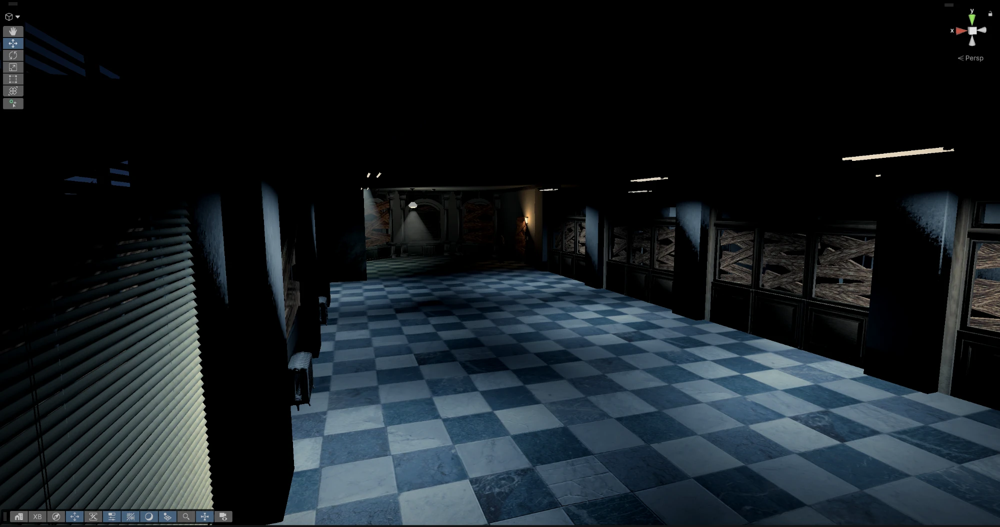
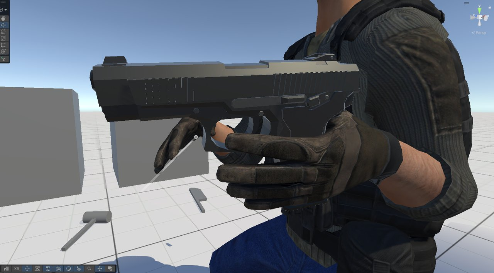

# SHELTER

[English](README.md)

SHELTER는 Meta Quest용 VR 좀비 서바이벌 게임입니다. 작은 쉘터에 고립된 플레이어가 안으로 밀려드는 좀비를 10라운드 동안 막아내며 살아남는 것이 목표입니다.

- 엔진: Unity 6000.5.2f1 (URP)
- VR: OpenXR, XR Interaction Toolkit 3
- 플랫폼: Meta Quest (Android)

<b>스크린샷</b>

 

**창문으로 넘어 들어오는 좀비**

**몰려오는 좀비 막아내기**

**쉘터 내부**

**플레이어 몸과 손 IK**

**권총 모델**

## 프로젝트 소개

2026년 7월부터 11월까지 3인 팀으로 개발한 프로젝트입니다. 개발은 종료되었으며, 이 저장소는 프로젝트 기록으로 보관하고 있습니다.

현재 버전은 싱글 플레이입니다. Photon Fusion 2 기반의 1~4인 협동 플레이를 계획했으나 구현하지는 못했습니다.

## 플레이 방법

쉘터 안에서 10라운드를 버티는 것이 목표입니다. 10라운드를 클리어하면 승리하고, 사망하면 게임이 종료됩니다.

좀비는 바깥에서 나타나 창문과 출입구의 판자를 뜯어내고 안으로 들어옵니다. 좀비를 처치하면 돈을 얻으며, 모은 돈은 다음과 같이 사용합니다.

- 자판기 상점에서 무기 구매: 권총, SMG, AR
- 재장전 (탄창마다 비용이 듭니다)
- 라운드 사이 쉬는 시간에 바리케이드 수리
- 구급상자에서 체력 회복

준비가 끝났다면 상점의 준비 완료 버튼으로 쉬는 시간을 건너뛰고 바로 다음 라운드를 시작할 수 있습니다.

타이틀 화면에서 게임 시작을 누르면 Normal과 Hard 중 난이도를 선택합니다. 게임을 클리어하거나 사망하면 다시 하기와 타이틀 이동을 선택하는 패널이 나타납니다.

튜토리얼에서는 이동, 구매, 사격, 재장전, 무기 장착, 수리 방법을 순서대로 익힐 수 있습니다.

## 조작법

| 입력 | 동작 |
|---|---|
| 왼쪽 스틱 | 이동 |
| 오른쪽 스틱 | 스냅 회전 |
| 트리거 | 잡기, 선택, 구매, 사격 |
| A / X | 재장전 |
| B / Y | 단발 / 연사 전환 |
| 왼쪽 메뉴 버튼 | 일시정지 메뉴 |
| 무기를 허리 근처에서 놓기 | 무기 장착 |

체력과 돈은 손등에서 확인할 수 있습니다.

## 시스템 구성

| 시스템 | 설명 |
|---|---|
| 라운드 | `RoundManager`가 쉬는 시간, 진행, 클리어, 승리, 패배 상태를 관리하며, 다른 시스템은 이 이벤트를 구독해 동작합니다. |
| 웨이브 | 라운드별 `WaveDefinition` 에셋이 등장할 좀비의 종류와 수를 정의합니다. `WaveManager`는 좀비를 여러 스폰 지점에 분산해 내보내고 동시에 살아 있는 수를 제한합니다. |
| 좀비 | `NavMeshAgent`로 이동합니다. 바깥에서는 배정된 바리케이드(없으면 가장 가까운 바리케이드)를 공격하고, 내부에 진입하면 가장 가까운 플레이어를 추적합니다. 창문을 넘어 진입하며, 처치되면 래그돌로 쓰러지고 오브젝트 풀로 재사용됩니다. |
| 바리케이드 | 창문과 출입구마다 판자가 설치되어 있습니다. 좀비의 공격 한 번에 판자가 하나씩 떨어지며, 플레이어는 비용을 내고 판자를 복구할 수 있습니다. |
| 경제 | 지갑, 처치 보상, 자판기 상점, 유료 재장전, 회복 스테이션으로 구성됩니다. |
| 전투 | 레이캐스트 방식 총기로, 단발·연사 전환, 탄창, 컨트롤러 진동, 허리 홀스터를 지원합니다. |
| 플레이어 | 체력과 피격 연출을 처리합니다. 아바타 몸은 헤드셋 위치를 따르고, 팔은 IK로 컨트롤러를 따라 움직입니다. |
| 난이도 | `DifficultyConfig`로 좀비 체력, 스폰 수, 동시 생존 수, 처치 보상의 배율을 조정합니다. |
| UI / 오디오 | 플레이어 앞에 배치되는 메뉴, 손목 정보 표시, 라운드 음악, 좀비 입체 음향으로 구성됩니다. |

밸런스 수치는 모두 `Assets/_Project/ScriptableObjects`의 ScriptableObject로 관리하므로, 코드를 수정하지 않고 조정할 수 있습니다.

## 밸런스

좀비

| 종류 | 체력 | 속도 (m/s) | 보상 | 처음 등장 |
|---|---|---|---|---|
| Walker | 100 | 1.5 | 80 | 1라운드 |
| Runner | 80 | 3.2 | 100 | 4라운드 |

무기

| 무기 | 가격 | 데미지 | 탄약 |
|---|---|---|---|
| 권총 | 300 | 37 | 15 |
| SMG | 900 | 22 | 40 |
| AR | 1800 | 28 | 60 |

- 시작 자금은 800입니다.
- 회복 비용은 400이며, 체력을 최대치까지 회복합니다.
- Normal 기준 라운드별 좀비 수: 6, 8, 10, 12, 15, 18, 21, 24, 28, 32
- 라운드 사이 쉬는 시간은 60초입니다.

Hard 모드에서는 좀비가 더 단단해지고 수도 늘어나며, 처치 보상은 줄어듭니다.

| 좀비 체력 | 스폰 수 | 동시 생존 수 | 처치 보상 |
|---|---|---|---|
| ×1.75 | ×1.5 | ×1.2 | ×0.6 |

## 실행 방법

1. Unity 6000.5.2f1을 Android Build Support와 함께 설치합니다.
2. 저장소를 클론한 뒤 Unity로 엽니다.
3. 아래 표에 있는 서드파티 에셋을 각 폴더에 임포트합니다.
4. 타이틀부터 보려면 `Assets/Scenes/Main.unity`를, 바로 게임을 하려면 `Assets/Scenes/TestScene.unity`를 엽니다.

서드파티 에셋 없이도 코드는 컴파일되지만, 모델·애니메이션·사운드는 표시되지 않습니다.

## 서드파티 에셋 (미포함)

아래 에셋은 라이선스상 재배포가 허용되지 않아 저장소에 포함하지 않았습니다.

| 폴더 | 내용 |
|---|---|
| `Assets/Plugins/RootMotion` | Final IK (RootMotion), 플레이어 몸 IK에 사용 |
| `Assets/Survivalist` | 플레이어 캐릭터 모델 (`StarterAssets`는 포함) |
| `Assets/ZombieMale_AAB` | 좀비 캐릭터 모델 |
| `Assets/Kevin Iglesias` | Human Basic Motions FREE, Human Melee Animations FREE |
| `Assets/Infima Games` | Low Poly Shooter Pack - Free Sample |
| `Assets/Weapon/Low Poly Pistol Weapon Pack 3` | 무기 모델 |
| `Assets/Weapon/Low Poly SMG Weapon Pack 2` | 무기 모델 |
| `Assets/Weapon/LowPoly_Tactical_Dagger` | 단검 모델 |
| `Assets/PBR_Materials_AL8310` | PBR 재질 |
| `Assets/YughuesFreeBushes2018` | 덤불 |
| `Assets/Map`, `Assets/Plank` | 쉘터 맵, 판자 모델 |
| `Assets/Resources/Animations` | 좀비 애니메이션 (Mixamo) |
| `Assets/Resources/SFX`, `Assets/Sounds` | 효과음, 음악 |

## 폴더 구조

| 경로 | 내용 |
|---|---|
| `Assets/_Project/Scripts` | 게임 코드(`Shelter.*`): 라운드, 웨이브, 좀비, 바리케이드, 경제, 플레이어, 난이도, UI, 오디오 |
| `Assets/_Project/ScriptableObjects` | 밸런스 데이터: 라운드, 웨이브, 좀비, 경제, 난이도 |
| `Assets/_Project/Prefabs` | 무기, UI, 플레이어 |
| `Assets/Scenes` | `Main`(타이틀), `TestScene`(게임) |
