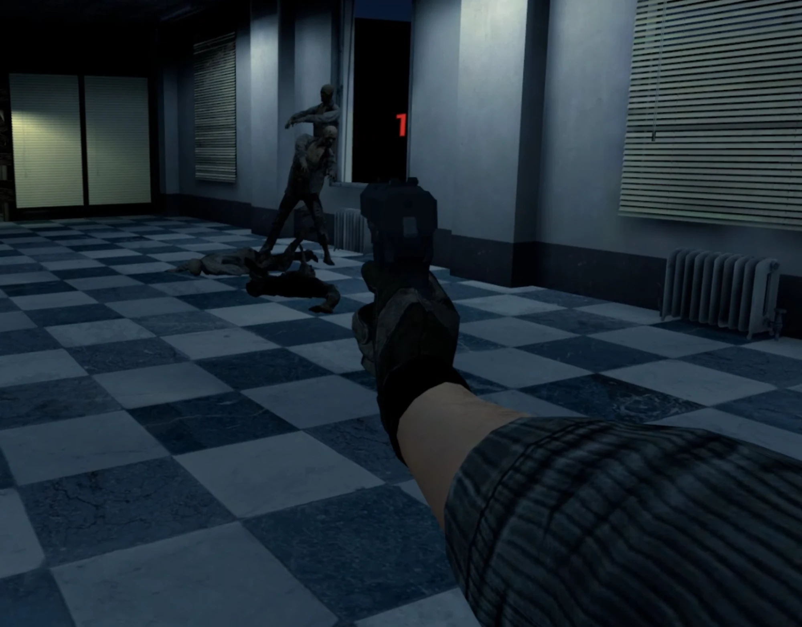
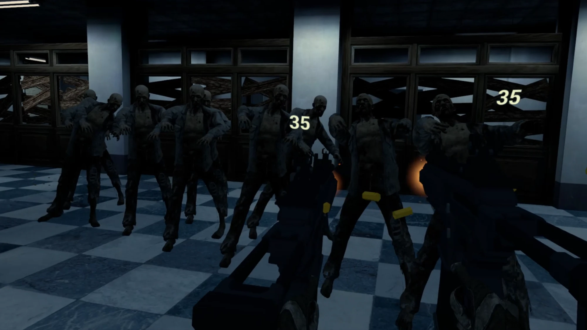
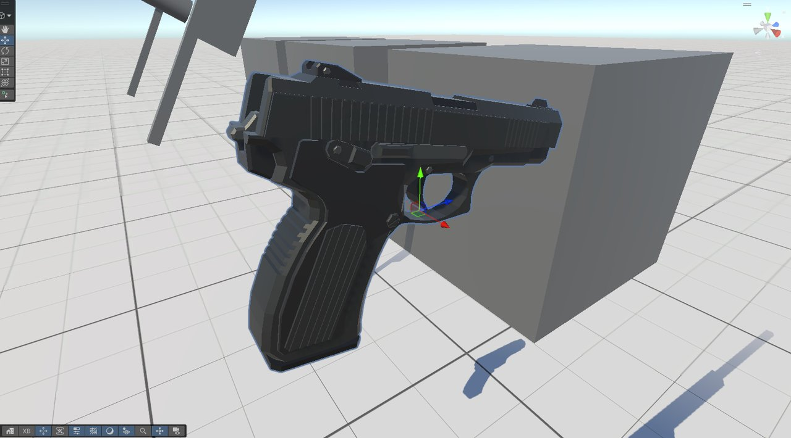

# SHELTER

[English](README.md)

SHELTER는 Meta Quest용 VR 좀비 서바이벌 게임입니다. 작은 쉘터에 갇힌 채, 안으로 들어오려는 좀비들을 10라운드 동안 막아내며 살아남는 게임이에요.

- 엔진: Unity 6000.5.2f1 (URP)
- VR: OpenXR, XR Interaction Toolkit 3
- 플랫폼: Meta Quest (Android)

<b>스크린샷</b>

 

**창문으로 넘어 들어오는 좀비**

**몰려오는 좀비 막아내기**

**쉘터 내부**

**플레이어 몸과 손 IK**

**권총 모델**

## 프로젝트 소개

2026년 7월부터 11월까지 3명이 함께 만든 팀 프로젝트입니다. 개발은 마무리되었고, 이 저장소는 프로젝트 기록으로 남겨 두었습니다.

지금은 혼자 플레이하는 버전입니다. 처음에는 Photon Fusion 2로 1~4인 협동 플레이를 계획했지만, 구현까지는 하지 못했습니다.

## 플레이 방법

쉘터 안에서 10라운드를 버티면 됩니다. 10라운드를 클리어하면 승리이고, 죽으면 게임이 끝납니다.

좀비는 바깥에서 나타나 창문과 출입구의 판자를 뜯고 안으로 넘어옵니다. 좀비를 처치하면 돈을 받고, 이 돈으로 다음을 할 수 있어요.

- 자판기 상점에서 무기 구매: 권총, SMG, AR
- 재장전 (탄창마다 비용이 듭니다)
- 라운드 사이 쉬는 시간에 바리케이드 수리
- 구급상자에서 체력 회복

쉬는 시간이 끝나기 전에 준비가 됐다면, 상점의 준비 완료 버튼을 눌러 바로 다음 라운드를 시작할 수 있습니다.

타이틀 화면에서 게임 시작을 누르면 Normal과 Hard 중에서 난이도를 고를 수 있습니다. 게임을 클리어하거나 죽으면 다시 하기와 타이틀로 돌아가기를 고르는 창이 나타납니다.

튜토리얼에서 이동, 구매, 사격, 재장전, 무기 장착, 수리 방법을 차례로 익힐 수 있습니다.

## 조작법

| 입력 | 동작 |
|---|---|
| 왼쪽 스틱 | 이동 |
| 오른쪽 스틱 | 스냅 회전 |
| 트리거 | 잡기, 선택, 구매, 사격 |
| A / X | 재장전 |
| B / Y | 단발 / 연사 전환 |
| 왼쪽 메뉴 버튼 | 일시정지 메뉴 |
| 무기를 허리 근처에서 놓기 | 무기 장착 |

체력과 돈은 손등에서 확인할 수 있습니다.

## 시스템 구성

| 시스템 | 설명 |
|---|---|
| 라운드 | `RoundManager`가 쉬는 시간, 진행, 클리어, 승리, 패배 상태를 관리합니다. 다른 시스템들은 이 이벤트를 받아서 움직입니다. |
| 웨이브 | 라운드마다 `WaveDefinition` 에셋이 하나씩 있어서, 어떤 좀비가 몇 마리 나올지 정합니다. `WaveManager`가 좀비를 여러 스폰 지점에 나눠 내보내고, 한 번에 살아 있을 수 있는 수를 조절합니다. |
| 좀비 | `NavMeshAgent`로 움직입니다. 바깥에서는 맡은 바리케이드(없으면 가장 가까운 곳)를 공격하고, 안에 들어오면 가장 가까운 플레이어를 쫓아갑니다. 창문을 넘어 들어오고, 죽으면 래그돌로 쓰러지며, 오브젝트 풀로 재사용됩니다. |
| 바리케이드 | 창문과 출입구마다 판자가 붙어 있습니다. 좀비가 한 번 칠 때마다 판자가 하나씩 떨어지고, 플레이어는 돈을 내고 다시 붙일 수 있습니다. |
| 경제 | 지갑, 처치 보상, 자판기 상점, 유료 재장전, 회복 스테이션으로 이루어져 있습니다. |
| 전투 | 레이캐스트 방식의 총기에 단발·연사, 탄창, 컨트롤러 진동, 허리 홀스터를 넣었습니다. |
| 플레이어 | 체력과 피격 연출이 있습니다. 아바타 몸은 헤드셋을 따라오고, 팔은 IK로 컨트롤러를 따라 움직입니다. |
| 난이도 | `DifficultyConfig`에서 좀비 체력, 스폰 수, 동시에 살아 있는 좀비 수, 처치 보상을 조절합니다. |
| UI / 오디오 | 플레이어 앞에 뜨는 메뉴, 손목 표시, 라운드 음악, 입체 음향으로 들리는 좀비 소리가 있습니다. |

밸런스 수치는 모두 `Assets/_Project/ScriptableObjects`의 ScriptableObject에 들어 있어서, 코드를 건드리지 않고도 조정할 수 있습니다.

## 밸런스

좀비

| 종류 | 체력 | 속도 (m/s) | 보상 | 처음 등장 |
|---|---|---|---|---|
| Walker | 100 | 1.5 | 80 | 1라운드 |
| Runner | 80 | 3.2 | 100 | 4라운드 |

무기

| 무기 | 가격 | 데미지 | 탄약 |
|---|---|---|---|
| 권총 | 300 | 37 | 15 |
| SMG | 900 | 22 | 40 |
| AR | 1800 | 28 | 60 |

- 시작 자금은 800입니다.
- 회복 비용은 400이고, 체력이 전부 찹니다.
- Normal 기준 라운드별 좀비 수: 6, 8, 10, 12, 15, 18, 21, 24, 28, 32
- 라운드 사이 쉬는 시간은 60초입니다.

Hard 모드에서는 좀비가 더 단단하고 많아지는 대신, 처치 보상은 줄어듭니다.

| 좀비 체력 | 스폰 수 | 동시 생존 수 | 처치 보상 |
|---|---|---|---|
| ×1.75 | ×1.5 | ×1.2 | ×0.6 |

## 실행 방법

1. Unity 6000.5.2f1을 Android Build Support와 함께 설치합니다.
2. 저장소를 클론한 뒤 Unity로 엽니다.
3. 아래 표에 있는 서드파티 에셋을 각 폴더에 임포트합니다.
4. 타이틀부터 보려면 `Assets/Scenes/Main.unity`를, 바로 게임을 하려면 `Assets/Scenes/TestScene.unity`를 엽니다.

서드파티 에셋이 없어도 코드는 컴파일됩니다. 다만 모델, 애니메이션, 사운드는 비어 있습니다.

## 서드파티 에셋 (미포함)

아래 에셋은 라이선스상 재배포할 수 없어서 저장소에 넣지 않았습니다.

| 폴더 | 내용 |
|---|---|
| `Assets/Plugins/RootMotion` | Final IK (RootMotion), 플레이어 몸 IK에 사용 |
| `Assets/Survivalist` | 플레이어 캐릭터 모델 (`StarterAssets`는 포함) |
| `Assets/ZombieMale_AAB` | 좀비 캐릭터 모델 |
| `Assets/Kevin Iglesias` | Human Basic Motions FREE, Human Melee Animations FREE |
| `Assets/Infima Games` | Low Poly Shooter Pack - Free Sample |
| `Assets/Weapon/Low Poly Pistol Weapon Pack 3` | 무기 모델 |
| `Assets/Weapon/Low Poly SMG Weapon Pack 2` | 무기 모델 |
| `Assets/Weapon/LowPoly_Tactical_Dagger` | 단검 모델 |
| `Assets/PBR_Materials_AL8310` | PBR 재질 |
| `Assets/YughuesFreeBushes2018` | 덤불 |
| `Assets/Map`, `Assets/Plank` | 쉘터 맵, 판자 모델 |
| `Assets/Resources/Animations` | 좀비 애니메이션 (Mixamo) |
| `Assets/Resources/SFX`, `Assets/Sounds` | 효과음, 음악 |

## 폴더 구조

| 경로 | 내용 |
|---|---|
| `Assets/_Project/Scripts` | 게임 코드(`Shelter.*`): 라운드, 웨이브, 좀비, 바리케이드, 경제, 플레이어, 난이도, UI, 오디오 |
| `Assets/_Project/ScriptableObjects` | 밸런스 데이터: 라운드, 웨이브, 좀비, 경제, 난이도 |
| `Assets/_Project/Prefabs` | 무기, UI, 플레이어 |
| `Assets/Scenes` | `Main`(타이틀), `TestScene`(게임) |
